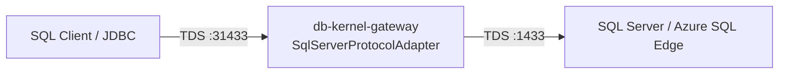

# SQL Server (TDS) 网关接入计划

> **决策**：第三协议为 **SQL Server / TDS**（非 Oracle）。  
> **分支**：`future/database-wire-protocol-foundation`  
> **状态**：P0 透明双工中继 + P1 观测/拒绝 + **P2 部分**：ROW 脱敏（fail-closed）、RPC/Bulk 观测、`sp_reset_connection` 池 reset。**仍非** MySQL/PG 对等（无 Login7 驱动选路；NBCROW/PLP/数值时间非空改写仍拒绝）。见 [STATUS_AND_GAPS.md](STATUS_AND_GAPS.md) P2-7。

## 1. 目标

在现有协议无关基础设施上，提供 **透明 TDS 网关**：

| 复用能力 | 来源 |
|---|---|
| 后端连接池 | `PooledBackendProvider` + `gateway.pool.*` |
| 客户端 TLS 终止 | `ClientTlsTerminator` + `gateway.tls.*` |
| 多后端 failover / 路由 | `RoutingBackendProvider` + `gateway.routing.*` |
| Session reset SPI | `BackendSessionReset` → `SqlServerBackendSessionReset`（`sp_reset_connection`；`reset-mode=protocol`） |
| 适配器注册 | `ProtocolAdapterRegistry`：`sqlserver` / `mssql` |

**不**做完整 TDS 改写引擎；默认路径是字节透明转发（与早期 MySQL/PG 一致）。

## 2. 架构



ASCII：

```
  Client ──TDS──▶ Gateway:31433 ──TDS──▶ SQL Server:1433
                    │
                    ├─ pool / TLS terminate / routing（基类）
                    ├─ DuplexRelay 透明双工（P0）
                    ├─ 明文观测 Login7/SQL_BATCH/ERROR/Attention/RPC/Bulk（P1/P2）
                    └─ 可选 ROW 脱敏 + pool reset（P2 partial）
```

## 3. 阶段

### P0（本提交）— 透明中继 + 生命周期

- [x] `SqlServerProtocolAdapter` 继承 `AbstractProtocolAdapter`
- [x] 注册 `sqlserver` / `mssql`（P0 曾为 `none()`；现为 `SqlServerBackendSessionReset`）
- [x] 最小 TDS：`TdsFrameCodec` / `TdsMessageFraming`（8 字节头、BE length、EOM 拼逻辑消息）
- [x] accept 后双工透明转发（PreLogin/Login7 等由客户端与后端自行完成）
- [x] `application-sqlserver-template.yml`（proxy-port **31433** → target **1433**，密码占位 `change-me`）
- [x] 单测：registry、framing、adapter start/stop、透明中继

**说明**：TDS 虽为 client-first（PreLogin），但 PreLogin 不含 user/database；`acquire` 使用空 `RoutingContext`（与 MySQL 首连类似）。Login7 / SQL_BATCH / ERROR / Attention **观测**已在双工路径落地（P1）；Login7 **不**驱动选路（须先与某后端完成 PreLogin；伪造 PreLogin 属握手终结，见 P2）。

### P1 — 基础观测与冒烟

- [x] 可解析时观测 Login7 用户 / 初始库（写入 `SqlServerSession` / `client.*` 属性 / `LOGIN7` 事件；记录 `routing.hint`；**明文**路径；**不**驱动 `acquire`）
- [x] 可解析时观测 SQL_BATCH 文本为 `SQL_BATCH` 流量事件（无 RPC 名解析）
- [x] 可解析时观测后端 ERROR token（`0xAA`）为 `ERROR` 流量事件；会话记录 `last.error.*`
- [x] 可解析时观测 Attention（`0x06`）与 DONE_ATTN（`ATTENTION` / `ATTENTION_ACK`）；同连接 observe-only，字节仍透明转发（不代发、不关后端）
- [x] 网关侧拒绝 / 风控拒绝 / acquire 失败：伪造最小 TDS `TABULAR_RESULT`（ERROR + DONE）；后端错误仍透明转发
- [x] `SqlServerLogin7Routing`：Login7 → `RoutingContext` 映射（单测覆盖）；透明路径 `probeClientForRouting` **仍 empty**（见下）
- [x] Docker Compose `sqlserver` profile + `SqlServerGatewayIntegrationTest` harness（无 Docker/`integration.sqlserver.password` 时 assumeTrue skip；见 §5）

### P2 — 深化（部分落地）

- [x] RPC 名观测（`RPC` 事件 / `RpcObservation`）+ Bulk Load 包观测（`BULK_LOAD`）；**不**改写 RPC/Bulk 载荷
- [x] 结果集脱敏：`SqlServerResultSetMaskingInterceptor`（REWRITE）；COLMETADATA→ROW；非空改写限 **nvarchar/nchar/varchar/char/uniqueidentifier**；NULL 规则对可编码布局；**NBCROW / PLP / TEXTPTR / 未知类型 / 数值·时间非空** fail-closed（DENY）
- [x] 协议级 `SqlServerBackendSessionReset`：`sp_reset_connection` RPC + 等 DONE/DONEPROC（无 ERROR）
- [ ] 更深 token 改写（NBCROW 位图、PLP 流、decimal/datetime 非空二进制改写）— **刻意延期**；当前拒绝而非猜测
- [ ] Login7 **驱动** `acquire(RoutingContext)`：需伪造 PreLogin 响应（部分握手终结），**透明代理不可行**；仅 cleartext 终结路径可另开设计
- [ ] 真库 Docker 冒烟证明（本构建环境 **无** `docker`/`podman`；有 Engine 的机器按 §5 + Compose profile 自测）

## 4. 非目标

- 完整 TDS 协议重写 / 认证终结（网关代登）
- Oracle TNS（仍为 stub；本决策明确第三库为 SQL Server）
- 将生产 SA 密码提交进 git

## 5. 本地 Docker（冒烟）

> **CI / 本构建环境**：默认 **不**要求 Docker。本环境已确认 **无** `docker`/`podman`，冒烟 **skip**；以单元测试为验收。有 Docker 的机器可用 Compose profile 或下列 `docker run` 自测。
>
> Compose：`docker compose --profile sqlserver up -d` → 宿主 **11433**（SA 默认 `Aa123456.`）。集成：`integration-test-local.properties` 设 `integration.enabled=true` + `integration.sqlserver.password=...`，再 `mvn -Pintegration-test test`（跑 `SqlServerGatewayIntegrationTest`）。


| 项 | 建议 |
|---|---|
| 镜像 | `mcr.microsoft.com/mssql/server:2022-latest`（x86_64）；Apple Silicon 可用 `mcr.microsoft.com/azure-sql-edge` |
| 端口 | 宿主 `1433:1433` |
| EULA | `ACCEPT_EULA=Y` |
| SA 密码 | **本地实验室示例**：`Aa123456.`（与本机 MySQL/PG Docker 习惯一致，含末尾点号） |
| 复杂度 | SQL Server 策略要求大小写 + 数字 + 符号；若策略拒绝，可改 `Aa123456!` 并同步本地 `application-dev.yml`（仍勿提交） |

示例（**仅 OPS / 本地**，勿写入已提交的 template 生产密钥）：

```bash
docker run -d --name mssql-lab \
  -e 'ACCEPT_EULA=Y' \
  -e 'MSSQL_SA_PASSWORD=Aa123456.' \
  -p 1433:1433 \
  mcr.microsoft.com/mssql/server:2022-latest
```

Apple Silicon 备选：

```bash
docker run -d --name mssql-lab \
  -e 'ACCEPT_EULA=Y' \
  -e 'MSSQL_SA_PASSWORD=Aa123456.' \
  -p 1433:1433 \
  mcr.microsoft.com/azure-sql-edge
```

若 `Aa123456.` 被策略拒绝，改用 `Aa123456!` 并在本地配置中同步。

## 6. 跑通网关（对着本地 SQL Server）

```bash
cp src/main/resources/application-sqlserver-template.yml \
   src/main/resources/application-dev.yml
# 编辑 application-dev.yml：gateway.target.password=Aa123456. （gitignore，勿 commit）
mvn spring-boot:run -Dspring-boot.run.profiles=dev
```

客户端连 **`localhost:31433`**（网关），目标库 **`localhost:1433`**。

JDBC 示例 URL：`jdbc:sqlserver://localhost:31433;databaseName=master;encrypt=false;trustServerCertificate=true`

## 7. 验收

| 项 | 标准 |
|---|---|
| 单元 | framing / registry / adapter 中继；`mvn test` 全绿 |
| 集成 | Docker 可用时可选冒烟；默认 CI **不**要求 Docker |
| 配置 | template 仅 `change-me`；本地密码只出现在 OPS/本计划与 gitignore 的 dev yml |

## 8. 代码入口

| 路径 | 角色 |
|---|---|
| `SqlServerProtocolAdapter` | 监听 / 会话 / DuplexRelay |
| `adapter/sqlserver/TdsFrameCodec` | 8 字节头编解码 |
| `adapter/sqlserver/TdsMessageFraming` | EOM 逻辑消息边界 |
| `adapter/sqlserver/SqlServerSession` | 会话状态（Login7 身份 + last ERROR + Attention 请求/确认） |
| `adapter/sqlserver/SqlServerDatabaseEventExtractor` / `Login7Observation` | P1 明文观测（Login7 + SQL_BATCH + ERROR + Attention/DONE_ATTN）；挂入 adapter 管线 |
| `adapter/sqlserver/SqlServerLogin7Routing` | Login7 → `RoutingContext` 映射（**不**用于透明 `acquire`） |
| `adapter/sqlserver/TdsErrorToken` / `TdsDoneToken` / `SqlServerGatewayErrorMapper` | ERROR 解析/伪造 + DONE/DONE_ATTN 解析；`ProtocolErrorResponder` 接线 |
| `adapter/sqlserver/SqlServerResultSetMaskingInterceptor` / `TdsColMetadata` / `TdsRowCodec` | ROW 脱敏（fail-closed NBCROW/PLP） |
| `adapter/sqlserver/SqlServerBackendSessionReset` / `RpcObservation` | 池 reset（`sp_reset_connection`）；RPC 名观测 |
| `application-sqlserver-template.yml` | 配置模板 |
| `docker-compose.yml` profile `sqlserver` | 可选真库（11433）；无 Docker 时跳过 |
| `SqlServerGatewayIntegrationTest` | `-Pintegration-test` + local props；否则 assumeTrue skip |
